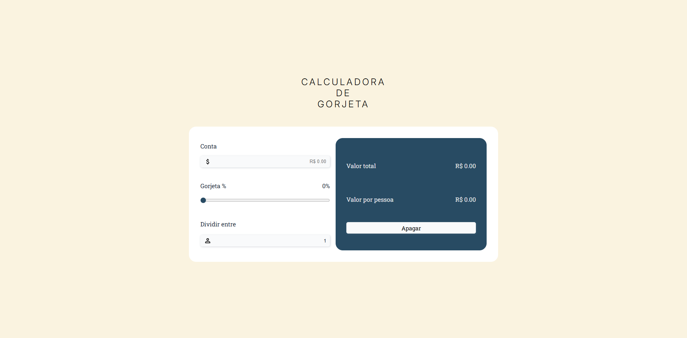

# 💰 Calculadora de Gorjeta

Calculadora para adicionar uma porcentagem de gorjeta à conta e dividir o valor entre várias pessoas.

🔗 [Acesse o site](https://gracicosta.github.io/Tip-Calculator/)

## 📷 Prévia

## ⚙️ Funcionalidades

- Informar o valor da conta.
- Escolher a porcentagem de gorjeta.
- Dividir o total entre várias pessoas.
- Consultar o valor total e o valor por pessoa.

## 🛠️ Tecnologias

- HTML
- CSS
- JavaScript

Projeto desenvolvido para estudo e prática de desenvolvimento web.
